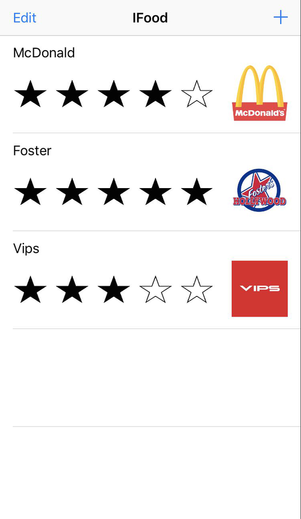
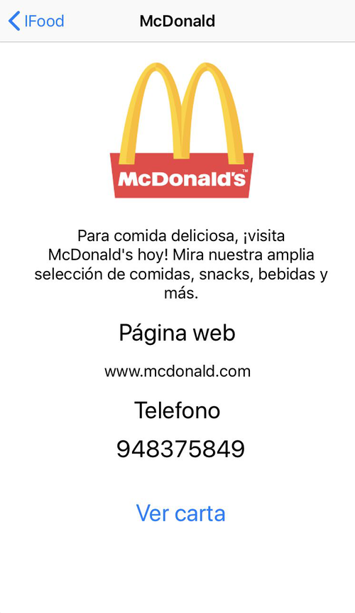
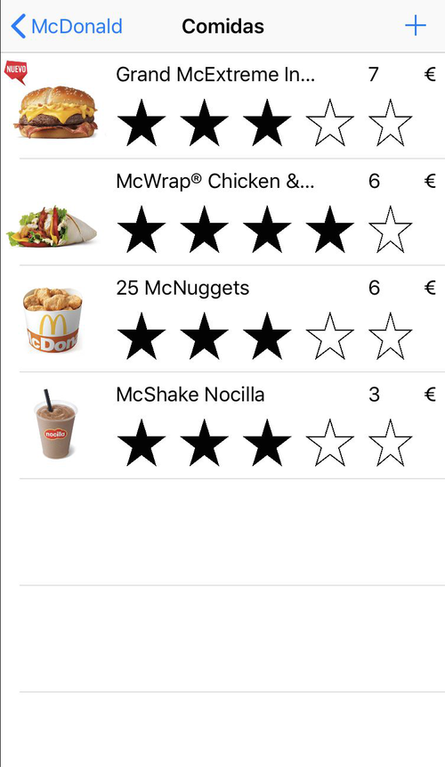
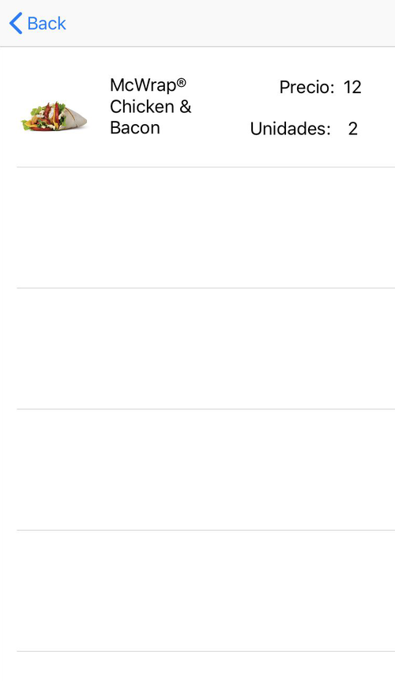

# Fast Food App


An iOS app to browse fast-food restaurants, look at their menus, build an order and send it to the
restaurant by email.

<table>
  <tr>
    <td align="center"></td>
    <td align="center"></td>
    <td align="center"></td>
    <td align="center"></td>
  </tr>
  <tr>
    <td align="center"><sub>Restaurants</sub></td>
    <td align="center"><sub>Restaurant detail</sub></td>
    <td align="center"><sub>Menu</sub></td>
    <td align="center"><sub>Current order</sub></td>
  </tr>
</table>

Built in 2019 as a university project: it starts from Apple's *FoodTracker* tutorial and grows into a
small restaurant + ordering flow with its own data model, local persistence and email checkout.

## Screens and design docs

The repository contains the original design documentation, which is the fastest way to see the app
without building it:

| Document | What it shows |
| :--- | :--- |
| [Manual de usuario](docs/Manual%20de%20usuario.pdf) | Every screen, step by step, with screenshots |
| [Estructura APP](docs/Estructura%20APP.pdf) | Architecture and data model |
| [Storyboard APP](docs/StoryboardAPP.pdf) | Storyboard and navigation flow |

## What it does

- **Restaurants** — list with photo, name, address, phone, email, description and a star rating
- **Menus** — each restaurant has its own dishes with photo, price and description; dishes can be added, edited and deleted
- **Orders** — add dishes with quantity and notes, see the running total
- **Checkout** — customer name, phone, address and email, plus the order summary, sent through the
  system mail composer (`MFMailComposeViewController`)
- **Persistence** — restaurants and orders are archived locally with `NSCoding`; there is no backend

## Architecture

Classic MVC with storyboards, one view controller per screen:

```
FoodTracker/
├── Restaurante.swift          # restaurant model: contact data, rating, menu
├── Meal.swift                 # dish model
├── pedido.swift               # order line: dish, units, notes, price
├── RestauranteTableViewController.swift
├── MealTableViewController.swift
├── PedidoViewController.swift
├── CompletarPedido.swift      # checkout + email
├── RatingControl.swift        # custom star-rating control
└── Assets.xcassets
```

Models implement `NSCoding` and are written to the app's `Documents` directory, so data survives
between launches. Screens pass state through `prepare(for:sender:)`, and the same controllers handle
both "add" and "edit" flows through an optional model property.

## Running it

```bash
open FoodTracker/FoodTracker.xcodeproj
```

Select an iPhone simulator and press `⌘R`.

> The project targets **Swift 3.0 / iOS 10 (Xcode 8)**. A current Xcode will ask to migrate the
> project and the Swift syntax before it builds — expected for a 2019 codebase.

## What I learned

- Turning a tutorial into a real domain model instead of adding screens on top of it
- Passing state between screens without a global singleton
- Local persistence with `NSCoding` when a backend is overkill
- Integrating a system framework (Mail) and handling its completion callbacks

## Credits and license

The starting point is Apple's *FoodTracker* sample code; its original license is kept in
[`docs/THIRD-PARTY-LICENSES.txt`](docs/THIRD-PARTY-LICENSES.txt). Everything added on top
(restaurants, menus, orders, checkout) is MIT licensed — see [LICENSE](LICENSE).
